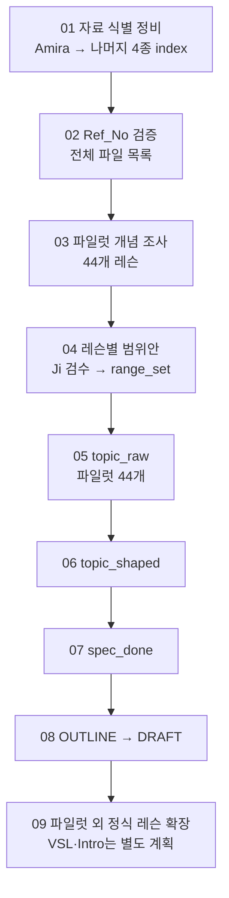

# 코스 제작 계획

> **강의 제작 로드맵·작업 규칙·결정 기록의 단일 출처다.** 지금 할 일은 [`to_do.md`](../../01_inbox/conversation_log/to_do.md), 용어는 [`glossary.md`](glossary.md), 레슨 설계법은 [`03_course_outline_and_draft/lesson_design_method.md`](03_course_outline_and_draft/lesson_design_method.md)에 둔다.
> 최종 갱신: 2026-09-17. 완료 체크, `range_set`, 개념 추출 기준 반영.

## 1. 목표

196개 커리큘럼 항목을 추적한다. 정식 레슨의 `lesson_spec`·OUTLINE·DRAFT 생산라인은 §9의 파일럿으로 먼저 검증한다. VSL과 Intro는 마케팅·course navigation·공부법 성격이므로 파일럿 생산라인에서 제외하며, 이후 제작 방식은 별도로 정한다.

## 2. 새 생산 순서



`V7`의 `Ji 레슨 주제`는 Ji의 의도를 찾는 참고자료다. 발췌의 기준이나 lesson_spec의 단일 출처로 쓰지 않는다. 기존 `topic_copy` 파일은 `_archive`에 보관하며 어떤 단계에서도 재사용하지 않는다.

## 3. 현재 작업과 완료 조건

완료 조건을 충족한 항목만 체크한다. 파일럿 전체 작업은 대상 레슨이 모두 끝났을 때 체크하고, 레슨별 진행은 §5의 검토표에서 관리한다.

- [x] 5종 index의 파일별 Ref_No 정비와 전체 작업 검토표 구성.
- [x] raw frontmatter에 Ref_No 반영·검증. 완료 기록: [[260916_log#Ref_No 최종 반영]].
- [x] `01_concept_index.xlsx`의 빈 시트 구조 생성. 완료 기록: [[260916_log]].
- [ ] 개념 workbook에 개정 설계 반영. 완료 조건: [[01_concept_index.xlsx_plan]]의 칼럼·행 구조·검증 기준과 일치.
- [ ] 파일럿 개념 조사. 완료 조건: §9 대상 파일의 직접 설명 개념과 검토·제외 사유를 기록.
- [ ] 파일럿 레슨별 범위 검수. 완료 조건: Ji 검수로 범위를 확정하고 각 레슨을 `range_set`으로 기록.
- [ ] 파일럿 `topic_raw`. 완료 조건: 승인 범위 발췌와 원문 문자열 대조 통과.
- [ ] 파일럿 `topic_shaped`. 완료 조건: 설명 범위·순서 구성과 검수 통과.
- [ ] 파일럿 `spec_done`. 완료 조건: 필수 필드와 근거·출처 검증 통과.
- [ ] 파일럿 OUTLINE·DRAFT. 완료 조건: L2-01 관통 검증과 파일럿 전체 Ji 검수 통과.
- [ ] 확장 계획. 완료 조건: 파일럿 결과로 확장 순서와 VSL·Intro의 별도 제작 방식 결정.

`to_do.md`는 하루 마감 때만 갱신한다. 이 목록이 전체 로드맵의 정본이다.

**현재 위치:** 자료 식별 정비와 개념 workbook의 빈 구조 생성까지 완료했다. 개정 설계를 workbook에 반영한 뒤 개념 조사와 범위 검수를 진행한다.

## 4. 자료 식별과 Ref_No

### 4-1. 헤더 이름으로 읽기

모든 xlsx는 열 번호가 아니라 **헤더 이름**으로 읽는다. 필수 헤더가 없거나 같은 헤더가 두 개면 작업을 멈추고 보고한다. V7의 정본 헤더는 `Ji 레벨`·`Ji 레슨`·`Ji 레슨 Title`이다.

### 4-2. Ref_No 원칙

Ref_No는 **특정 레슨 폴더의 실제 Markdown 파일 하나**를 가리킨다. 같은 원본의 다른 레슨 사본은 레슨마다 다른 Ref_No를 가진다.

5종 index 정비는 완료했다. 이후에도 정확한 기존 번호와 변경 대응 기록을 유지하고, 번호는 트랙 접두어·레슨별 순번을 따른 고정 텍스트로 저장한다. `02_ext_sources`와 `03_original_PDF`는 일괄 작업 대상이 아니다.

예외로, Hangul 1·3·4·6에는 `02_ext_sources/02_한글` 원본 4개의 레슨별 복사본을 `06_ext_sources` 트랙에 등록했다. 복사본의 Ref_No는 `EXT-HG-레슨-문서 순서` 형식을 쓰며, 매핑·사용 구간·원본 근거는 `06_ext_sources_index.xlsx`가 정본이다.

Amira의 같은 Day 자료도 Script·PPT+Script 통합본·각 Zoom Part·Summary를 각각 한 파일로 등록한다. Day 20의 AI 생성 Script는 Ji의 실제 발화나 톤 근거로 사용하지 않는다.

### 4-3. raw 파일 반영

Ref_No 반영과 본문 보존 검증은 완료했다. 실행·검증 내역은 [[260916_log#Ref_No 최종 반영]]에 둔다. 당시 승인은 완료된 작업에 한하며 raw는 계속 읽기 전용이다.

## 5. 작업 검토표

`01_lesson_spec/lesson_spec_tracking.xlsx`는 확정된 Ref_No를 쓰는 작업용 검토표다.

| 시트 | 한 행 | 역할 |
|---|---|---|
| `파일관리` | 실제 파일 1개 | Ref_No, 경로, 자료형태, 검토·발췌·원문검증 결과 |
| `외부자료` | Hangul 외부자료 복사본 1개 | `06_ext_sources_index.xlsx`와 같은 Ref_No·경로로 관리하는 Hangul 1·3·4·6 전용 목록 |
| `레슨진행` | 레슨 1개 | 레슨별 진행 단계와 산출물 상태 |
| `작업이력` | 작업 사건 1개 | 작업일시, 특이사항, 조치내용, 미해결 사항 |

`status`는 다음 5단계를 순서대로 쓴다.

| status | 의미·진입 조건 |
|---|---|
| `raw_mapped` | 레슨과 raw 파일의 Ref_No·경로 연결 확인 완료. 개념 조사·범위 제안 중에도 이 상태를 유지 |
| `range_set` | 레슨에서 가르칠 개념의 범위가 Ji 검수로 확정됨. 확정 기준은 [[01_concept_index.xlsx_plan#레슨별범위]] 참조 |
| `topic_raw` | `range_set`을 확인한 뒤 승인 범위의 원문 발췌 spec 작성 |
| `topic_shaped` | 발췌를 바탕으로 설명 범위·순서 구성 |
| `spec_done` | 필수 필드를 채우고 검증한 완료 spec |

개념 작업은 spec 작성과 별도다. `range_set`은 그 결과인 범위 확정을 확인하는 단계이며, 이때 spec 파일이나 새 작업 폴더를 만들지 않는다. `range_set`을 거치지 않은 레슨은 `topic_raw`로 넘어갈 수 없다.

`미검토 / 진행 중 / 확인 대기 / 완료 / 보류 / 제외`는 별도 `검토 상태` 칼럼에서 관리한다. Markdown이 만들어지는 `topic_raw`부터 frontmatter, 작업 폴더, 검토표의 status가 일치해야 한다.

## 6. 개념 조사와 범위 검수

개념 작업장은 `01_lesson_spec/01_concept/`이다. `01_concept_index.xlsx`의 시트·칼럼, 직접 설명 개념의 추출 기준, Agent 범위 제안과 Ji 검수 방법은 [[01_concept_index.xlsx_plan]]에 둔다. 현재 조사 대상은 §9의 파일럿이다. 조사·등록은 레슨별 매핑 자료 전체를 단위로 하며, 미해결 사항은 [[concept_review_questions]]에 모은다. 상세 판정·계속 작업·완료 조건은 위 설계를 따른다. 범위 확정 후 §5의 `range_set`을 확인하고 발췌로 진행한다.

트랙별 조사 범위는 다음과 같다.

- Ji Draft: 본문 전체.
- YouTube: `Teaching Points`만. `Transcript`는 조사·발췌에서 제외하며, 이것만 있는 파일은 제외 사유를 남긴다.
- Amira: Script·Summary 본문, 통합본의 슬라이드 설명, 녹화본의 Teaching Points·Lesson Flow·Student Notes. 실제 발화 확인이 필요한 경우에만 해당 Transcript를 출처로 쓴다.
- HTSK·web: 본문의 설명과 예문. 탐색 메뉴 등은 제외한다.

## 7. lesson_spec 단계

spec은 새로 작성하며 복사본을 늘리지 않는다. 작업 폴더는 raw의 레벨·레슨 폴더 구조와 철자까지 같아야 한다.

```text
01_concept/                 개념 조사·범위 검수. spec 파일 없음
02_topic_raw/               승인 범위의 원문 발췌를 넣은 새 spec
03_topic_shaped/            범위와 설명 순서를 구성한 spec
04_spec_done/               필드를 채우고 검증한 완료 spec
```

### topic_raw

`range_set`인 레슨에서 승인 범위에 필요한 원문만 발췌한다. `RAW_DIGEST`에는 Ref_No·파일 경로·Markdown 줄 번호·원문을 남긴다. 원문을 요약하거나 고쳐 쓰지 않으며, 조건·예외·부정 예문처럼 의미가 이어지는 내용은 함께 남긴다. 개념 조사표의 짧은 위치 인용과 달리 실제 발췌 본문은 줄이지 않는다. 원문 문자열 대조와 범위 근거 누락 검사를 각각 한다.

### topic_shaped

발췌와 승인 범위를 바탕으로 `TEACHING_POINTS`의 순서와 경계를 구성한다. 자료 간 충돌은 출처별로 기록하며, 동일 세션의 Script·통합본·녹화본을 독립 증거처럼 중복 계산하지 않는다.

### spec_done

§8의 필드를 채워 완료한다. 기존 계획에 적힌 `lesson_spec_template.md`는 현재 없으므로 양식 마련이 필요하다. `NEW`·`PREREQ`·`THROUGH_LINE`은 `개념사전`의 표준명만 쓴다. `RAW_DIGEST`는 완료본에도 남긴다.

## 8. lesson_spec 필드와 예문 규칙

필드 10개는 `GOAL · SKELETON · TEACHING_POINTS · NEW · PREREQ · BUDGET · THROUGH_LINE · OUT_OF_SCOPE · SOURCES · OPEN`이다.

- `GOAL`은 학생이 할 수 있는 행동을 한 문장으로 쓴다.
- `TEACHING_POINTS`의 순서는 강의 순서다.
- `OUT_OF_SCOPE`에는 미루는 실제 레슨을 함께 쓴다.
- `SOURCES`는 Obsidian 링크가 아닌 경로로 기록한다.
- `BUDGET`은 앞 레슨의 `NEW`와 **이번 레슨에서 해당 시점까지 설명한 문법**을 합친다. 아직 설명하지 않은 문법이 들어간 예문은 검수 대상으로 남긴다.

VSL은 문법 BUDGET에서 제외한다. Intro의 학습 안내도 문법 선행조건으로 자동 계산하지 않는다.

## 9. 파일럿과 확장

파일럿은 Hangul 6, Numbers 7, Level 1 21, Level 2 10의 **44개 레슨**이다. 현재 raw는 Hangul 58, Numbers 44, Level 1 313, Level 2 123개로 총 **538개**다. Hangul 수에는 `06_ext_sources` 복사본 4개가 포함된다. VSL과 Intro는 정식 레슨이 아니며 마케팅·course navigation·공부법 성격이 강하므로 표준 Draft 생산라인의 파일럿에서 제외한다. L2-01은 spec에서 OUTLINE까지 먼저 관통해 Ji 친작 Draft와 대조한다. 파일럿 검증 후 파일럿 외 정식 레슨의 확장 순서와 VSL·Intro의 별도 제작 방식을 결정한다.

**2026-09-17 수치 확인:** 기존 5종 index 기준 파일럿은 Hangul 54, Numbers 44, Level 1 313, Level 2 123개로 534개다. 여기에 Hangul 외부자료 복사본 4개를 더해 실제 파일럿 Markdown은 538개다. Level 1-6의 `1-06_Past_Tense_Pt.1_-_Conjugation.md`에 적힌 `Ji-1-6-1`은 `파일관리` Ref_No 목록에 없으므로 별도 확인 대상으로 유지한다.

## 10. 결정 기록

| 번호 | 결정 | 결과 | 날짜 |
|---|---|---|---|
| DP-2 | 문서 구조 | raw / spec / outline / draft 4층, raw는 링크 없이 읽기 전용 | 2026-09-13 개정 |
| DP-3 | lesson_spec 필드 | 10개로 시작하고 검증 후 보완 | 2026-09-04 |
| DP-4 | 개념 관리 | 개념 Markdown 페이지 없이 `01_concept/01_concept_index.xlsx` 사용. 설계는 §6 참조 | 2026-09-17 개정 |
| DP-5 | 파일럿 | 대상과 파일 수 확인사항은 §9 참조 | 2026-09-17 확인 |
| DP-6 | 단계와 게이트 | §2 생산 순서와 §5의 범위 확정 조건을 따름 | 2026-09-17 개정 |
| DP-7 | raw 취합 | 전량 취합 없이 승인 범위로 조준 발췌 | 유지 |
| DP-8 | status | `range_set`을 포함한 5단계. 정의·진입 조건은 §5 참조 | 2026-09-17 개정 |
| DP-10 | Ref_No | index를 먼저 파일 단위로 정비한 뒤 raw와 tracking에 반영 | 2026-09-15 개정 |
| DP-11 | spec 시작점 | V7 주제 복사본을 쓰지 않으며 `02_topic_raw`에서 새로 작성 | 2026-09-15 개정 |

## 11. 리스크와 방지책

| 위험 | 방지책 |
|---|---|
| 잘못된 Ref_No가 이후 산출물에 전파 | Amira부터 5종 index를 파일 단위로 검토한 뒤 tracking을 작성 |
| 자료에 나온 내용을 전부 레슨 범위로 오인 | 자료별개념과 레슨별범위를 분리하고 Ji가 레벨별 검수 |
| raw 본문 훼손 | Ref_No 외 바이트 변경 0을 대조 |
| 출처 없는 발췌·환각 | 원문 인용, Ref_No·구간 기록, 문자열 대조 |
| 예문이 아직 설명하지 않은 문법을 사용 | BUDGET과 설명 시점 대조 |

## 12. 최종 상태

§9에서 확정한 파일럿 대상에 spec·outline·draft가 한 세트로 존재하고, 각 spec의 개념·발췌·출처·범위가 되짚을 수 있어야 한다. 그 결과를 바탕으로 파일럿 외 정식 레슨 확장과 VSL·Intro의 별도 제작 방식을 결정한다.
